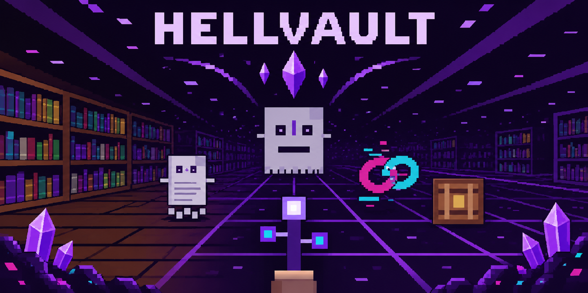

<b>English</b> · <a href="README.ru.md">Русский</a>

  

<h1 align="center">HELLVAULT</h1>

  <b>A Doom-like shooter inside Obsidian.</b> 
  Notes have become monsters. Links lead into darkness. The Vault needs its Keeper.

◆ Pixel art &nbsp;·&nbsp; Three modes &nbsp;·&nbsp; Obsidian desktop only ◆

---

Corruption has severed the connections between notes and reached the Core. Take up your Quill, find the obsidian shards, and stop the **Blank Note** before the Vault becomes a clean page.

## 🎮 Three ways to play

- **📖 Story** — explore five zones, collect seven shards, break the seals, and fight your way to the final boss. Search for secrets and diary pages along the way.
- **⚔️ Linear Path** — keep moving, fight off enemies that spawn over time, and defeat the boss at the end. No shards to hunt for here.
- **♾️ Endless Arena** — survive waves, smash supply crates, and choose an upgrade after each wave. A boss arrives every fifth wave, and your best runs make the records table.

> The arena unlocks after your first story victory on any difficulty. Each mode has its own save.

## ✨ Features

- **Three weapons:** the Quill with unlimited ink, the Wikilink Shotgun, and the Graph Laser.
- **Familiar enemies:** Orphans, Broken Links, Duplicates, Spam Tags, and the Blank Note.
- **Three difficulties:** from Easy to Hard, where the Keeper has just **1 HP**.
- **Explore and collect:** secrets, a Codex, 12 diary pages, and 21 achievements.
- **Your vault becomes part of the game:** enemies and gravestones can use note titles. Choose included folders, exclude private folders, or turn note names off.
- **Original soundtracks:** each mode has its own synthesized action theme — *Ashes of the Vault*, *The Long Way Down*, and *Fifth Wave* — with separate music and effects controls.
- **Kill log:** see defeated enemies in the pause menu and open their associated notes. The feed uses your signed-in ObsiGama nickname when available.

## 📸 In-game

| The Archive | Arena boss fight |
|:---:|:---:|
|  |  |

*Gameplay images were captured in a test environment. The cover and mode illustration are inspired by the game's artwork.*

## 🚀 Installation

Requires **Obsidian 1.4.0 or newer** on a desktop computer.

1. [Download `main.js`, `manifest.json`, and `styles.css` from the latest release](https://github.com/NOMBER/HELLVAULT/releases/latest).
2. Create `<your vault>/.obsidian/plugins/vault-shards/` and copy the three files into it.
3. In Obsidian, open **Settings → Community plugins**, refresh the list, and enable **Hellvault**.
4. Launch the game with the crystal icon or the **Open HELLVAULT** command.

Release files include GitHub provenance attestations; for example, verify `main.js` with `gh attestation verify main.js --repo NOMBER/HELLVAULT`.

When updating, keep your existing `data.json`: it contains your progress, settings, and records. Keep the `vault-shards` folder name for compatibility with earlier versions. If you installed a test build numbered `2.1.0`, replace the plugin files manually: Obsidian will not automatically update to a lower version.

**Language / Язык:** switch between English and Russian in the game settings or the plugin settings. New installations start in English; existing saves keep Russian.

## 🌐 Vault access and optional OBSIGAMA sync

HELLVAULT works offline. When note names are enabled, the game indexes Markdown note titles and paths across the vault for enemy names and gravestones; it does not read note contents for this feature. You can limit the index to selected folders, exclude folders and subfolders, refresh it, or turn the feature off in the plugin settings. An empty inclusion list means the whole vault; exclusions always take precedence. If no notes match, the game uses fictional fallback names and the settings show the index status. The last 1,000 kill-log entries, including note paths and the displayed player nickname, stay in the local plugin save. The optional Codex export creates or replaces its generated note in the vault.

[OBSIGAMA](https://github.com/NOMBER/ObsiGama) is an optional gaming hub. **Connect to OBSIGAMA** is off by default. If you install the hub and enable the switch in **Settings → Hellvault**, the game shares run counts, active gameplay time (excluding pauses and menus), enemy kills, deaths, victories, collected pages, achievements, and arena/story records with the local hub. With an account and online sync enabled, OBSIGAMA may send that information to its Supabase service for profiles and leaderboards. Note names and vault contents are not included. Your progress remains local while the switch is off; without the hub or an online connection it remains available locally and can be synced later.

## ⌨️ Controls

| Keys | Action |
|---|---|
| **W A S D / ↑ ↓** | move |
| **Mouse / ← →** | look and turn |
| **Left click / Space** | fire |
| **1–3 / wheel / Q** | change weapon |
| **Shift** | run |
| **E / F** | inspect a wall or open a secret |
| **M / Tab** | map |
| **Esc** | pause and menu |

The original game is maintained as the existing bundled JavaScript in `src/hellvault.js`, the original sequenced music is in `src/music.js`, and the OBSIGAMA integration and SDK are TypeScript. Run `npm ci`, then `npm run build` to generate `main.js` and `npm test` to run the checks. The SDK is copied from [ObsiGama](https://github.com/NOMBER/ObsiGama/tree/sdk-v0.1.0/packages/sdk) under its [MIT license](src/obsigama/sdk/LICENSE).

<b>Your Vault can still be saved. ◆</b>

License: <a href="LICENSE">MIT</a>

<a href="https://nomberobsidian.github.io">🌐 Author's website</a> &nbsp;·&nbsp; <a href="https://donatre.github.io">💜 Support the project</a>

