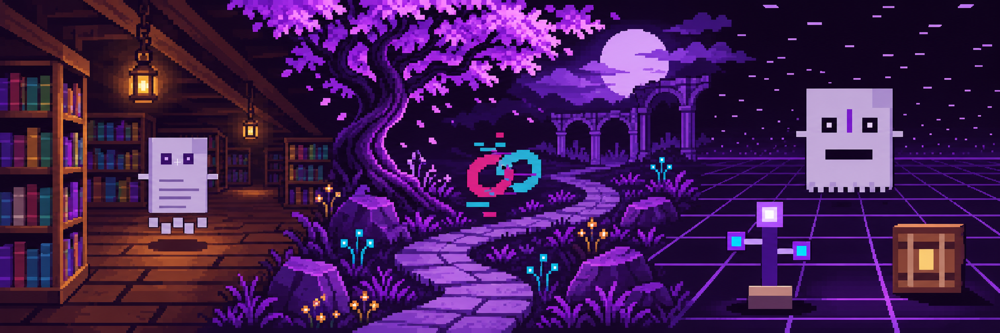
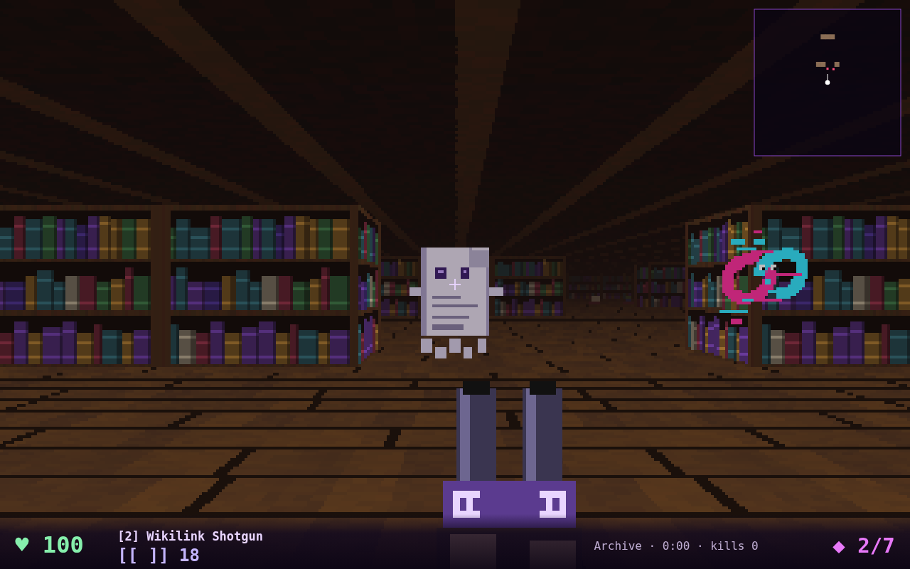
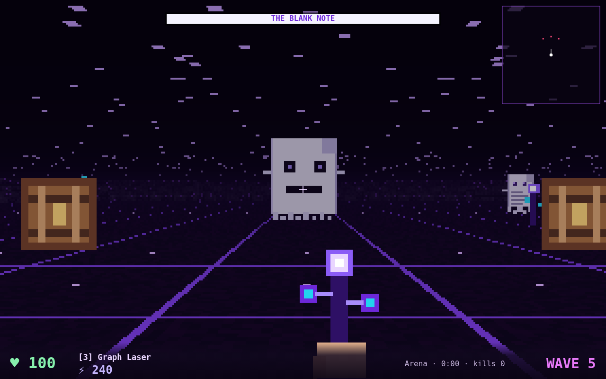

<b>English</b> · <a href="README.ru.md">Русский</a>

  

<h1 align="center">HELLVAULT</h1>

  <b>A Doom-like shooter inside Obsidian.</b> 
  Notes have become monsters. Links lead into darkness. The Vault needs its Keeper.

◆ Pixel art &nbsp;·&nbsp; Three modes &nbsp;·&nbsp; Obsidian desktop only ◆

---

Corruption has severed the connections between notes and reached the Core. Take up your Quill, find the obsidian shards, and stop the **Blank Note** before the Vault becomes a clean page.

## 🎮 Three ways to play

- **📖 Story** — explore five zones, collect seven shards, break the seals, and fight your way to the final boss. Search for secrets and diary pages along the way.
- **⚔️ Linear Path** — keep moving, fight off enemies that spawn over time, and defeat the boss at the end. No shards to hunt for here.
- **♾️ Endless Arena** — survive waves, smash supply crates, and choose an upgrade after each wave. A boss arrives every fifth wave, and your best runs make the records table.

> The arena unlocks after your first story victory on any difficulty. Each mode has its own save.

## ✨ Features

- **Three weapons:** the Quill with unlimited ink, the Wikilink Shotgun, and the Graph Laser.
- **Familiar enemies:** Orphans, Broken Links, Duplicates, Spam Tags, and the Blank Note.
- **Three difficulties:** from Easy to Hard, where the Keeper has just **1 HP**.
- **Explore and collect:** secrets, a Codex, 12 diary pages, and 21 achievements.
- **Your vault becomes part of the game:** some enemies and gravestones use the names of your notes. Exclude folders in the settings or turn this feature off.

## 📸 In-game

| The Archive | Arena boss fight |
|:---:|:---:|
|  |  |

*Gameplay images were captured in a test environment. The cover and mode illustration are inspired by the game's artwork.*

## 🚀 Installation

Requires **Obsidian 1.4.0 or newer** on a desktop computer.

1. [Download the plugin archive from the latest release](https://github.com/NOMBER/HELLVAULT/releases/latest) and extract it.
2. Create `<your vault>/.obsidian/plugins/vault-shards/` and copy `main.js`, `manifest.json`, and `styles.css` into it.
3. In Obsidian, open **Settings → Community plugins**, refresh the list, and enable **HELLVAULT**.
4. Launch the game with the crystal icon or the **Open HELLVAULT** command.

When updating, keep your existing `data.json`: it contains your progress, settings, and records. Keep the `vault-shards` folder name for compatibility with earlier versions.

**Language / Язык:** switch between English and Russian in the game settings or the plugin settings. New installations start in English; existing saves keep Russian.

## ⌨️ Controls

| Keys | Action |
|---|---|
| **W A S D / ↑ ↓** | move |
| **Mouse / ← →** | look and turn |
| **Left click / Space** | fire |
| **1–3 / wheel / Q** | change weapon |
| **Shift** | run |
| **E / F** | inspect a wall or open a secret |
| **M / Tab** | map |
| **Esc** | pause and menu |

The repository contains the bundled plugin code in `main.js`. Run the localization checks with `node --test tests/localization.test.js`.

<b>Your Vault can still be saved. ◆</b>

License: <a href="LICENSE">MIT</a>

<a href="https://nomberobsidian.github.io">🌐 Author's website</a> &nbsp;·&nbsp; <a href="https://donatre.github.io">💜 Support the project</a>

