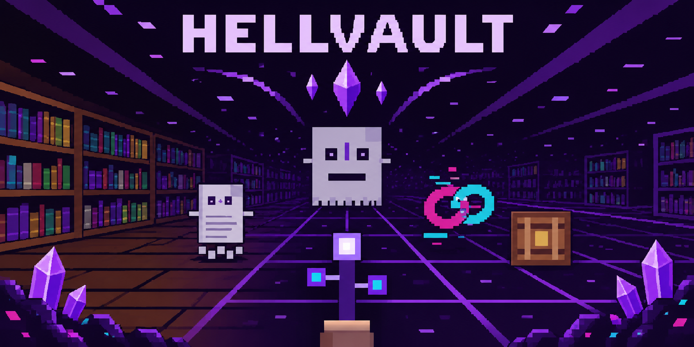
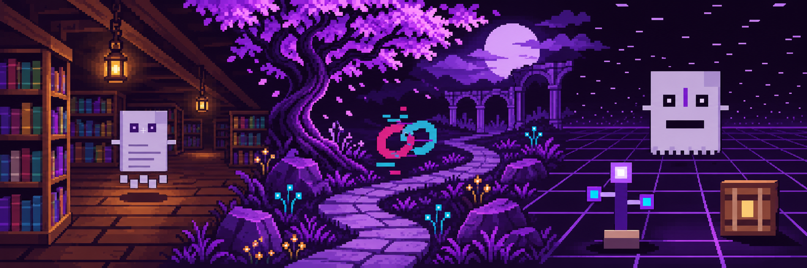
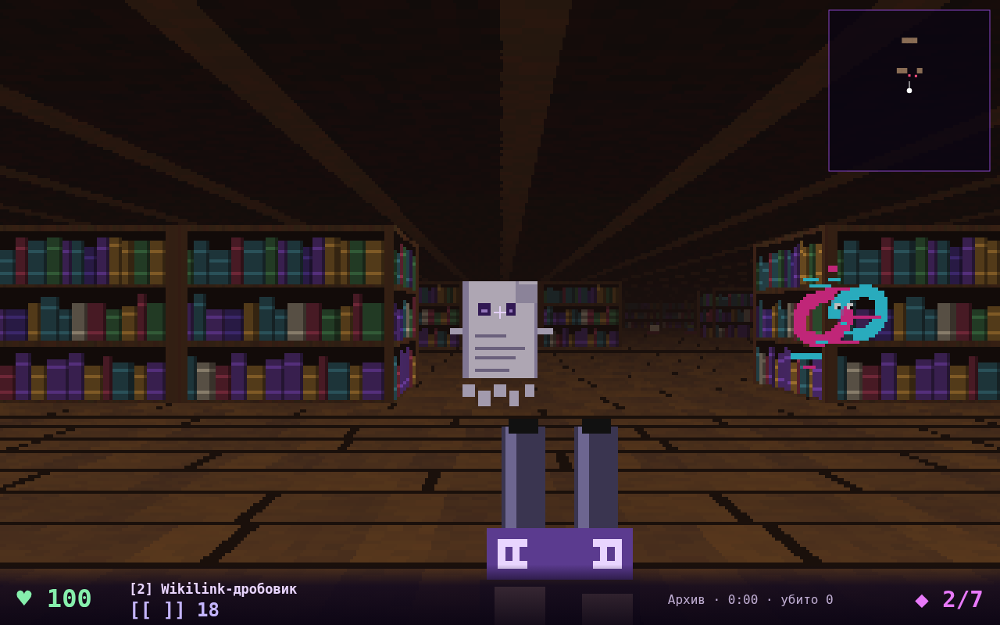
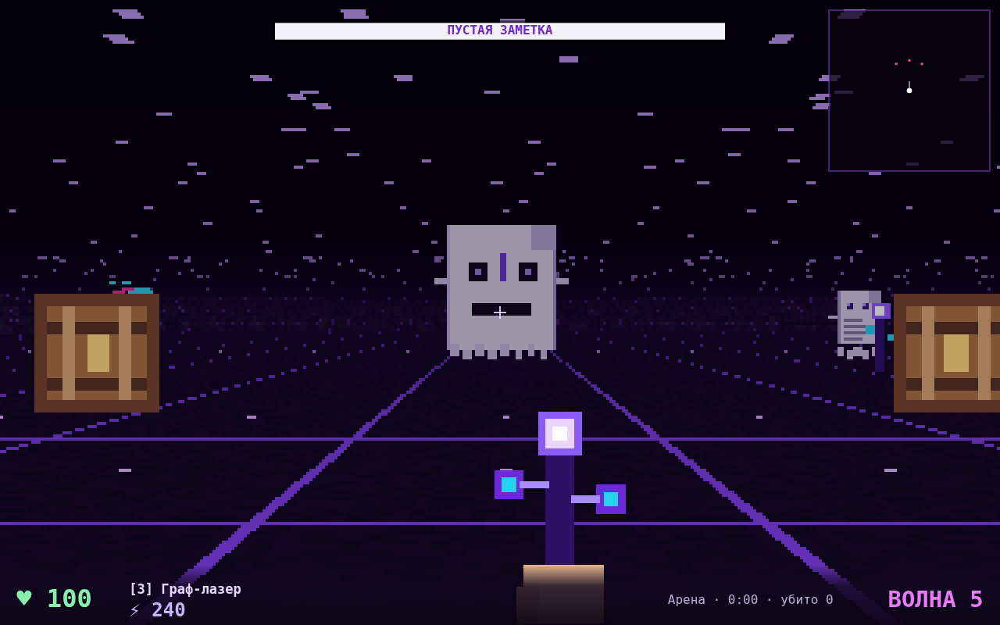

<a href="README.md">English</a> · <b>Русский</b>

  

<h1 align="center">HELLVAULT</h1>

  <b>Doom-подобный шутер прямо внутри Obsidian.</b> 
  Заметки стали монстрами. Ссылки ведут во тьму. Хранилище ждёт своего Хранителя.

◆ Пиксельная графика &nbsp;·&nbsp; Три режима &nbsp;·&nbsp; Только для десктопного Obsidian ◆

---

Порча разорвала связи между заметками и добралась до самого Ядра. Вооружись Пером, найди осколки обсидиана и останови **Пустую Заметку**, пока всё Хранилище не превратилось в чистый лист.

## 🎮 Три способа играть

- **📖 История** — исследуй пять зон, собирай семь осколков, открывай печати и пробивайся к финальному боссу. По пути ищи тайники и страницы дневника.
- **⚔️ Линейный путь** — двигайся вперёд, отбивайся от появляющихся врагов и победи босса в конце маршрута. Искать осколки здесь не придётся.
- **♾️ Бесконечная арена** — переживай волны, разбивай ящики с припасами и выбирай улучшение после каждой волны. Каждая пятая встречает тебя боссом, а лучший результат попадает в таблицу рекордов.

> Арена откроется после первого прохождения истории на любой сложности. У каждого режима — своё сохранение.

## ✨ Что внутри

- **Три вида оружия:** Перо с бесконечными чернилами, Wikilink-дробовик и Граф-лазер.
- **Знакомые враги:** Сироты, Битые ссылки, Дубликаты, Спам-теги и Пустая Заметка.
- **Три сложности:** от лёгкой до харда, где у Хранителя всего **1 HP**.
- **Исследование и коллекция:** тайники, Кодекс, 12 страниц дневника и 21 достижение.
- **Хранилище становится частью игры:** некоторые враги и надгробия получают названия твоих заметок. Ненужные папки можно исключить в настройках или отключить эту функцию.

## 📸 Как выглядит игра

| Архив | Битва на арене |
|:---:|:---:|
|  |  |

*Игровые кадры сняты в тестовом окружении. Обложка и иллюстрация режимов созданы по мотивам графики игры.*

## 🚀 Установка

Нужен **Obsidian 1.4.0 или новее** на компьютере.

1. [Скачай архив плагина из последнего релиза](https://github.com/NOMBER/HELLVAULT/releases/latest) и распакуй его.
2. Создай папку `<хранилище>/.obsidian/plugins/vault-shards/` и скопируй в неё из архива `main.js`, `manifest.json` и `styles.css`.
3. В Obsidian открой **Настройки → Сторонние плагины**, обнови список и включи **HELLVAULT**.
4. Запусти игру значком кристалла или командой **«Открыть HELLVAULT»**.

При обновлении сохрани существующий `data.json`: в нём находятся прогресс, настройки и рекорды. Не переименовывай папку `vault-shards` — так сохраняется совместимость с прежней версией. Если у тебя стоит тестовая сборка `2.1.0` или первоначальная `1.0.0`, замени файлы плагина вручную: Obsidian не обновляется автоматически до той же или более низкой версии.

**Язык / Language:** выбери русский или английский в настройках игры либо плагина. Новые установки запускаются на английском; существующие сохранения сохраняют русский язык.

## ⌨️ Управление

| Клавиши | Действие |
|---|---|
| **W A S D / ↑ ↓** | движение |
| **Мышь / ← →** | обзор и поворот |
| **ЛКМ / Пробел** | выстрел |
| **1–3 / колесо / Q** | смена оружия |
| **Shift** | бег |
| **E / F** | осмотреть стену или открыть тайник |
| **M / Tab** | карта |
| **Esc** | пауза и меню |

В репозитории лежит собранный код плагина в `main.js`. Проверить локализацию можно командой `node --test tests/localization.test.js`.

<b>Твоё Хранилище ещё можно спасти. ◆</b>

Лицензия: <a href="LICENSE">MIT</a>

<a href="https://nomberobsidian.github.io">🌐 Сайт автора</a> &nbsp;·&nbsp; <a href="https://donatre.github.io">💜 Поддержать проект</a>

